# Práctica N° 4 — Tablón de Anuncios con Flask

> **Documento base para el informe PDF.** Reemplazar los datos entre corchetes por los
> correspondientes al estudiante y exportar a PDF (por ejemplo, desde Word, Google Docs,
> Obsidian o con un editor Markdown).

---

## Portada

**Universidad:** Universidad Pública de El Alto  
**Facultad:** [Nombre de la facultad]  
**Carrera:** [Nombre de la carrera]  
**Asignatura:** [Nombre de la asignatura]  
**Título:** Aplicación web: Tablón de Anuncios con Flask  
**Desarrollado por:** Mayte  
**Docente:** [Nombre del docente]  
**Fecha:** [Noviembre de 2026]

---

## Índice

1. Introducción
2. Objetivos
3. Marco teórico
4. Diseño de la base de datos
5. Arquitectura de la aplicación
6. Funcionalidades implementadas
7. Capturas de pantalla
8. Pruebas realizadas
9. Instalación y ejecución
10. Conclusiones

---

## 1. Introducción

El presente trabajo consiste en el desarrollo de una aplicación web para gestionar un
tablón de anuncios institucional. La aplicación permite publicar, consultar, modificar y
eliminar anuncios, organizados por categorías y asociados a los usuarios que los crean.

El sistema incorpora autenticación de usuarios, control de acceso por roles y una
interfaz web responsive construida con Bootstrap. La persistencia de datos se realiza en
una base de datos relacional MariaDB, mientras que el backend se desarrolló con Python y
Flask aplicando el patrón **Application Factory** y la organización de rutas mediante
**Blueprints**.

## 2. Objetivos

### Objetivo general

Desarrollar una aplicación web con Flask que permita administrar un tablón de anuncios
utilizando una base de datos relacional y una arquitectura modular.

### Objetivos específicos

- Diseñar la base de datos `bd_anuncios` con las tablas `usuarios`, `categorias` y
  `anuncios`, respetando claves primarias, claves foráneas y relaciones.
- Implementar un sistema de autenticación con sesiones y contraseñas almacenadas de forma
  segura.
- Implementar el CRUD completo de usuarios, categorías y anuncios.
- Aplicar el patrón Application Factory mediante `create_app()` y organizar las rutas en
  Blueprints.
- Construir una interfaz común con cabecera institucional, menú de navegación, área de
  contenido y pie de página.

## 3. Marco teórico

### Flask

Flask es un microframework web para Python. Proporciona el enrutamiento, el manejo de
peticiones y respuestas y la integración con motores de plantillas Jinja2, dejando que el
desarrollador elija las extensiones que necesita.

### Application Factory

El patrón Application Factory consiste en crear la aplicación dentro de una función
(`create_app()`) en lugar de hacerlo en un objeto global. Esto facilita la configuración
por entornos, la escritura de pruebas y la inicialización de extensiones.

### Blueprints

Los Blueprints permiten agrupar rutas, plantillas y lógica relacionada. En este proyecto
se utilizan cinco: `main`, `auth`, `usuarios`, `categorias` y `anuncios`.

### ORM y Flask-SQLAlchemy

Flask-SQLAlchemy integra SQLAlchemy con Flask. Los modelos se definen como clases Python
y el ORM se encarga de traducirlos a tablas y consultas SQL, reduciendo el código
repetitivo y los errores de seguridad.

### Bootstrap

Bootstrap 5 es un framework CSS que ofrece componentes y utilidades responsive. Se utilizó
para la cabecera, el menú, las tarjetas, las tablas, los formularios, los mensajes y la
paginación.

## 4. Diseño de la base de datos

### 4.1. Modelo entidad-relación

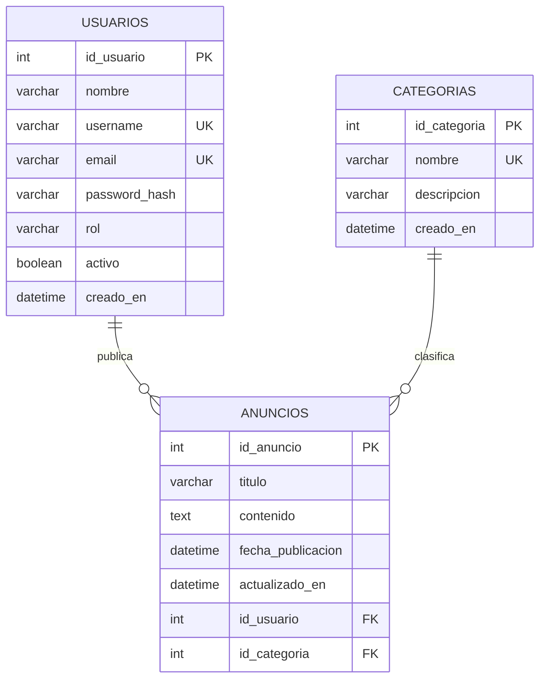

### 4.2. Tabla `usuarios`

Almacena las cuentas que pueden iniciar sesión. La contraseña se guarda como hash
generado con Werkzeug. El campo `rol` determina los permisos (`admin` o `usuario`) y el
campo `activo` permite deshabilitar cuentas sin eliminarlas.

| Campo | Tipo | Restricciones |
|---|---|---|
| `id_usuario` | INT | PK, AUTO_INCREMENT |
| `nombre` | VARCHAR(120) | NOT NULL |
| `username` | VARCHAR(50) | NOT NULL, UNIQUE |
| `email` | VARCHAR(150) | NOT NULL, UNIQUE |
| `password_hash` | VARCHAR(255) | NOT NULL |
| `rol` | VARCHAR(20) | NOT NULL, CHECK (`admin`/`usuario`) |
| `activo` | TINYINT(1) | NOT NULL, DEFAULT 1 |
| `creado_en` | DATETIME | NOT NULL, DEFAULT CURRENT_TIMESTAMP |

### 4.3. Tabla `categorias`

Clasifica los anuncios. El nombre es único para evitar duplicados.

| Campo | Tipo | Restricciones |
|---|---|---|
| `id_categoria` | INT | PK, AUTO_INCREMENT |
| `nombre` | VARCHAR(80) | NOT NULL, UNIQUE |
| `descripcion` | VARCHAR(255) | NULL |
| `creado_en` | DATETIME | NOT NULL, DEFAULT CURRENT_TIMESTAMP |

### 4.4. Tabla `anuncios`

Contiene las publicaciones del tablón. Cada anuncio tiene un autor y una categoría.

| Campo | Tipo | Restricciones |
|---|---|---|
| `id_anuncio` | INT | PK, AUTO_INCREMENT |
| `titulo` | VARCHAR(150) | NOT NULL |
| `contenido` | TEXT | NOT NULL |
| `fecha_publicacion` | DATETIME | NOT NULL, DEFAULT CURRENT_TIMESTAMP |
| `actualizado_en` | DATETIME | NOT NULL, ON UPDATE CURRENT_TIMESTAMP |
| `id_usuario` | INT | FK → `usuarios.id_usuario`, CASCADE |
| `id_categoria` | INT | FK → `categorias.id_categoria`, RESTRICT |

### 4.5. Relaciones e integridad referencial

- **Usuarios – Anuncios (1:N):** un usuario puede publicar muchos anuncios; cada anuncio
  pertenece a un único usuario. La clave foránea `id_usuario` usa `ON DELETE CASCADE`.
- **Categorías – Anuncios (1:N):** una categoría puede agrupar muchos anuncios; cada
  anuncio pertenece a una única categoría. La clave foránea `id_categoria` usa
  `ON DELETE RESTRICT` para impedir eliminar categorías con publicaciones.

El diseño se encuentra en tercera forma normal (3FN): cada tabla tiene una clave primaria,
los atributos dependen únicamente de ella y no existen dependencias transitivas.

## 5. Arquitectura de la aplicación

```text
practica4_emergentes/
├── app/
│   ├── __init__.py          # create_app()
│   ├── extensions.py        # db, login_manager
│   ├── models.py            # Usuario, Categoria, Anuncio
│   ├── decorators.py        # @admin_required
│   ├── utils.py             # validaciones
│   ├── cli.py               # init-db / seed-db / reset-db
│   ├── blueprints/
│   │   ├── main.py          # tablón público
│   │   ├── auth.py          # login / logout
│   │   ├── usuarios.py      # CRUD usuarios
│   │   ├── categorias.py    # CRUD categorías
│   │   └── anuncios.py      # CRUD anuncios
│   ├── templates/
│   │   ├── base.html        # layout común
│   │   ├── macros.html
│   │   ├── auth/ main/ usuarios/ categorias/ anuncios/ errors/
│   └── static/css/styles.css
├── database/
│   ├── setup.sql            # base de datos y usuario
│   └── schema.sql           # tablas y relaciones
├── tests/                   # pruebas con pytest
├── config.py
├── run.py
└── requirements.txt
```

La función `create_app()` recibe una clase de configuración, inicializa las extensiones,
registra los Blueprints, los comandos CLI y los manejadores de errores. De esta manera, la
misma aplicación puede ejecutarse con configuración de desarrollo, pruebas o producción
sin modificar el código.

## 6. Funcionalidades implementadas

### 6.1. Autenticación

- Inicio de sesión con nombre de usuario **o** correo electrónico.
- Verificación de contraseña mediante hash.
- Mensajes de error genéricos para no revelar si el usuario existe.
- Cierre de sesión mediante `POST`.
- Cuentas deshabilitadas no pueden iniciar sesión.

### 6.2. Administración de usuarios

- Registro, consulta, modificación y eliminación.
- Roles `admin` y `usuario`.
- Validación de nombre, usuario, correo, contraseña y unicidad.
- Protecciones: un administrador no puede eliminarse a sí mismo ni dejar el sistema sin
  administradores activos.

### 6.3. Administración de categorías

- CRUD completo.
- Validación de nombre único y longitud.
- No se permite eliminar una categoría con anuncios asociados.

### 6.4. Administración de anuncios

- CRUD completo.
- Asociación con una categoría y con el usuario autor.
- Edición y eliminación permitidas al autor del anuncio o a un administrador.
- Búsqueda por título/contenido y filtro por categoría.

### 6.5. Interfaz

- Cabecera institucional, menú de navegación, contenido y pie comunes (`base.html`).
- Diseño responsive con Bootstrap 5 e iconografía de Bootstrap Icons.
- Mensajes flash, badges de estado, paginación y páginas de error personalizadas.

## 7. Capturas de pantalla

> Las imágenes se generan automáticamente en `docs/capturas/` y se referencian a
> continuación. Reemplazar por capturas propias si se desea mostrar datos diferentes.

### 7.1. Página principal pública


### 7.2. Inicio de sesión

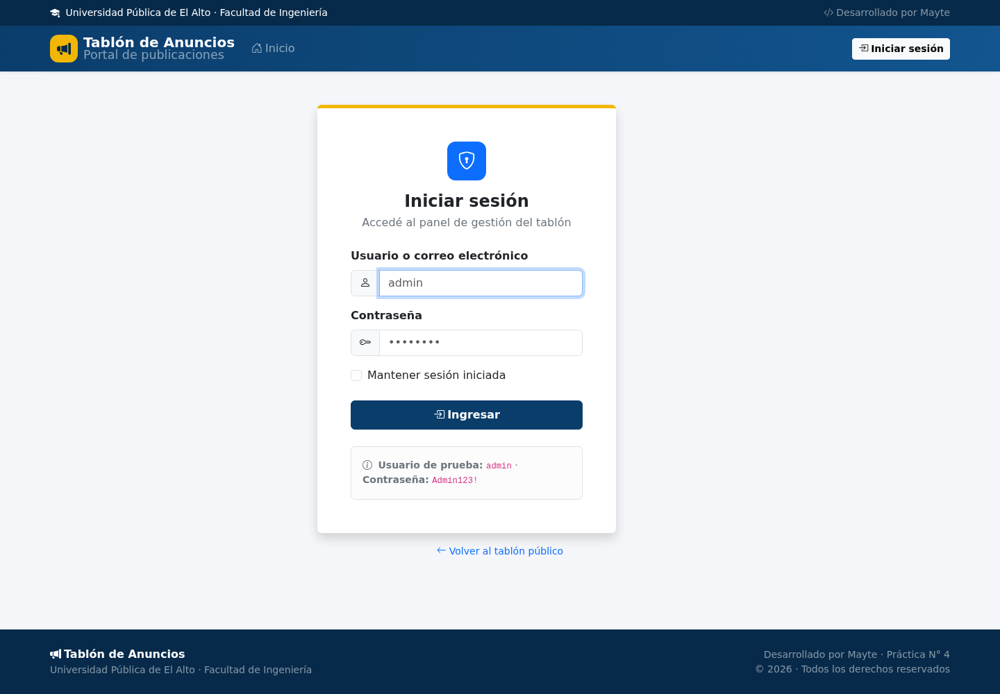

### 7.3. Tablón con sesión iniciada


### 7.4. Administración de usuarios

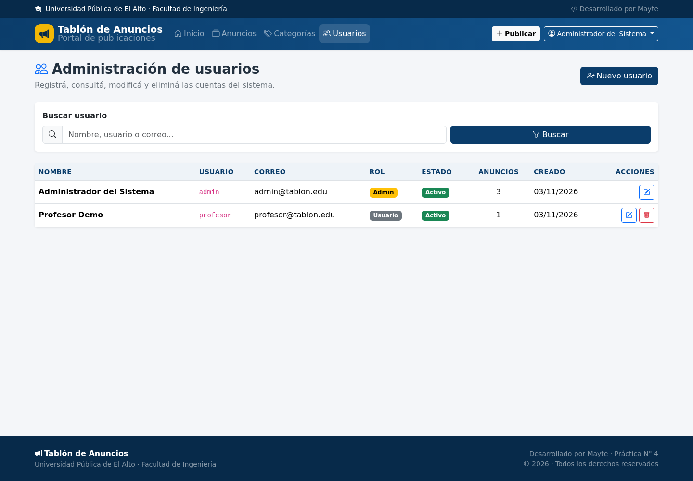

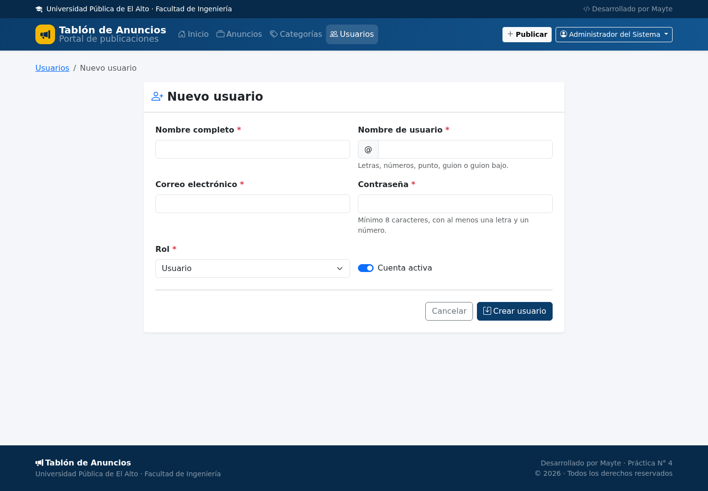

### 7.5. Administración de categorías

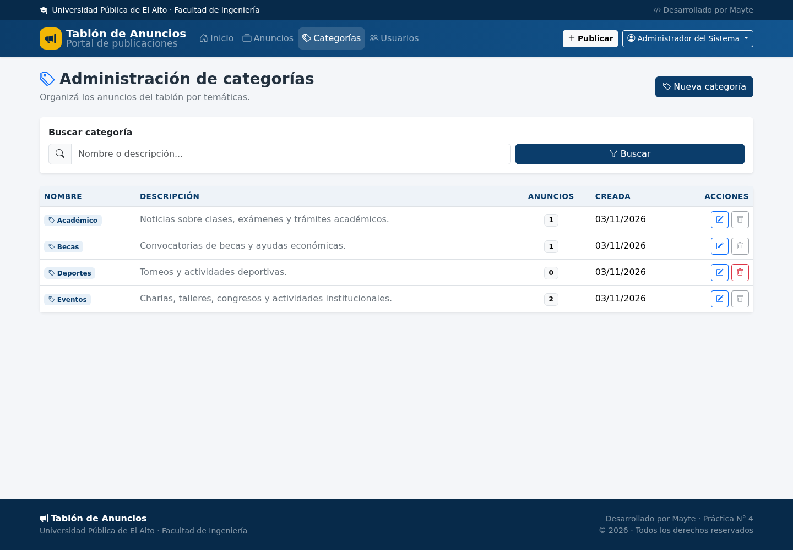

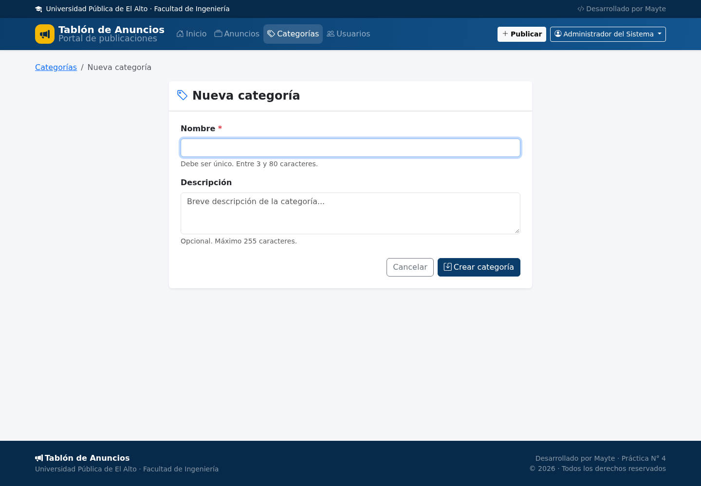

### 7.6. Administración de anuncios

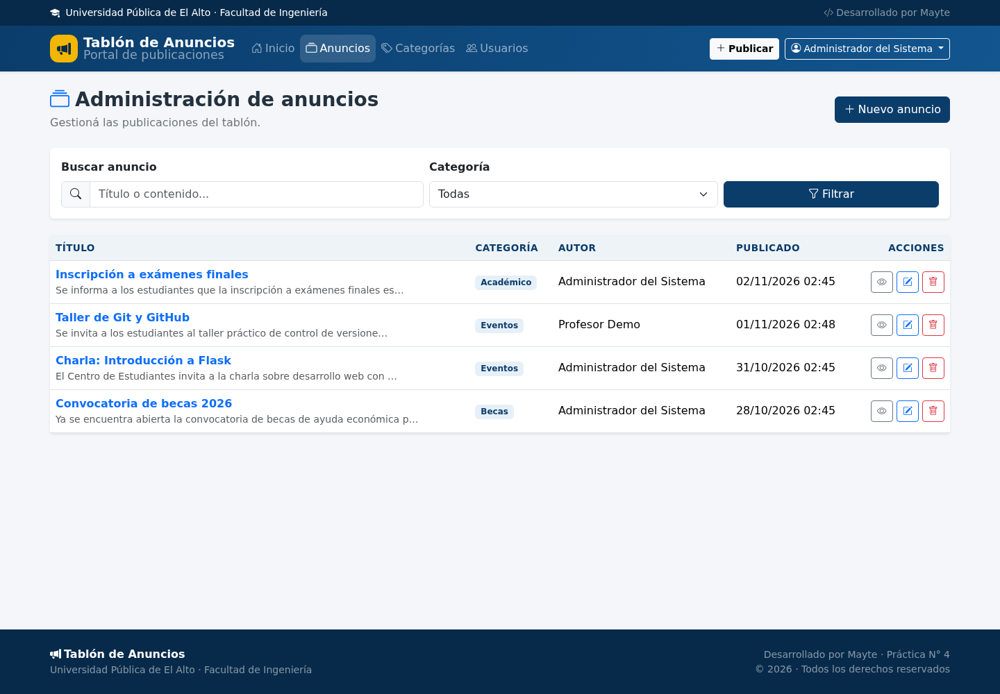

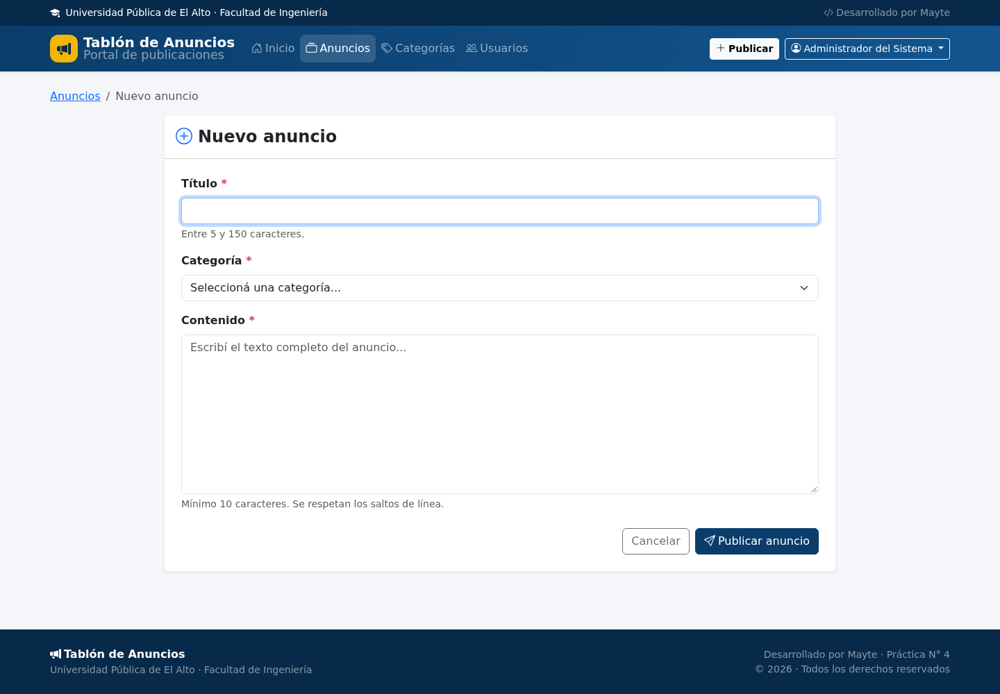

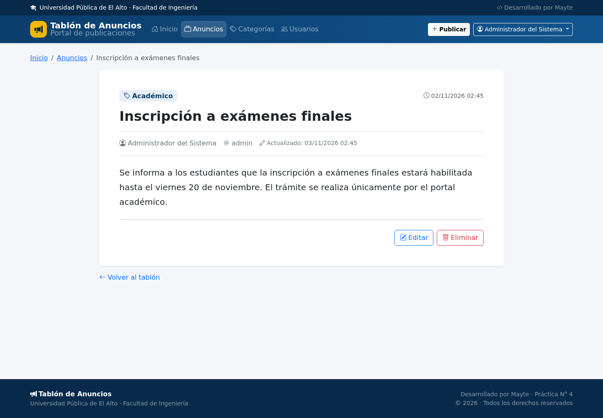

### 7.7. Validaciones y control de acceso

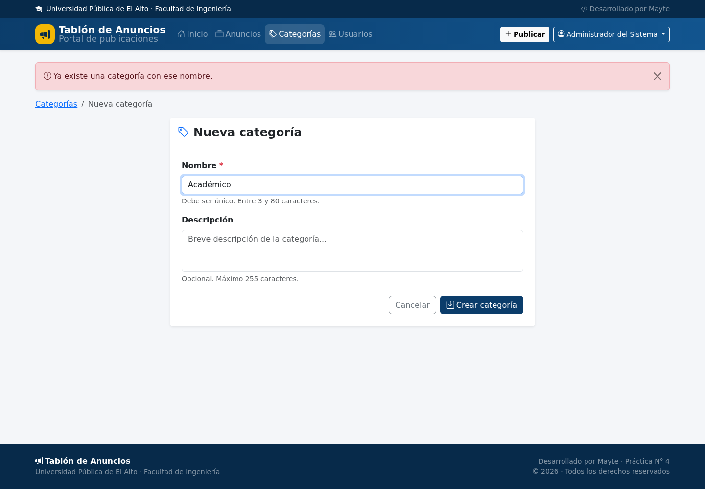

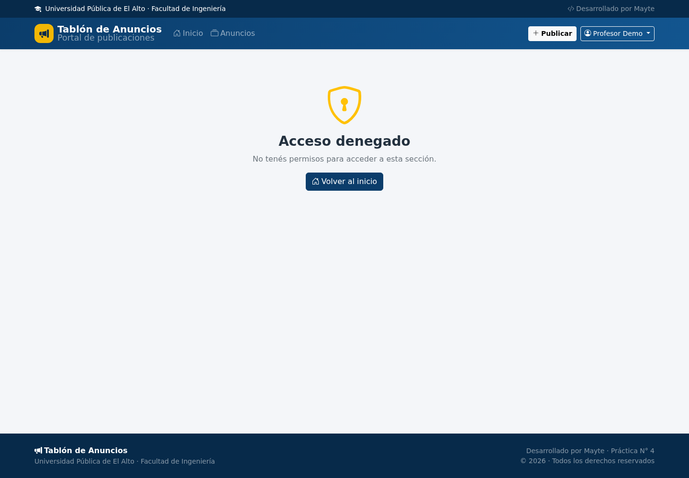

## 8. Pruebas realizadas

Se implementó una suite con `pytest` que utiliza una base SQLite en memoria. Resultado:

```text
18 passed
```

| N.º | Caso de prueba | Resultado |
|---|---|---|
| 1 | Página principal pública | Correcto |
| 2 | Login con contraseña incorrecta | Correcto |
| 3 | Login exitoso y cierre de sesión | Correcto |
| 4 | Acceso anónimo redirige al login | Correcto |
| 5 | Usuario normal no accede a usuarios (403) | Correcto |
| 6 | Crear categoría | Correcto |
| 7 | Categoría duplicada rechazada | Correcto |
| 8 | No eliminar categoría con anuncios | Correcto |
| 9 | Crear anuncio | Correcto |
| 10 | Validación de anuncio sin categoría | Correcto |
| 11 | Autor edita su anuncio | Correcto |
| 12 | Otro usuario no edita anuncio ajeno (403) | Correcto |
| 13 | Eliminar anuncio | Correcto |
| 14 | Crear usuario | Correcto |
| 15 | No eliminar la propia cuenta | Correcto |
| 16 | Página 404 para recurso inexistente | Correcto |
| 17 | Archivos estáticos disponibles | Correcto |
| 18 | Paginación del tablón | Correcto |

Para ejecutarlas:

```bash
pip install -r requirements-dev.txt
pytest
```

## 9. Instalación y ejecución

```bash
# 1. Base de datos
mysql -u root -p < database/setup.sql
mysql -u root -p < database/schema.sql

# 2. Entorno virtual
python3 -m venv .venv
source .venv/bin/activate
pip install -r requirements.txt

# 3. Configuración
cp .env.example .env

# 4. Datos iniciales
flask --app run.py seed-db

# 5. Ejecutar
flask --app run.py run --debug
```

Abrir <http://127.0.0.1:5000> e iniciar sesión con `admin` / `Admin123!`.

## 10. Conclusiones

La aplicación cumple con los requerimientos de la práctica: utiliza una base de datos
relacional con claves primarias y foráneas, implementa autenticación, ofrece el CRUD de
usuarios, categorías y anuncios, y aplica correctamente el patrón Application Factory con
Blueprints.

La separación por módulos facilitó el mantenimiento y las pruebas. El uso de un ORM
permitió mantener la integridad de las relaciones, mientras que Bootstrap proporcionó una
interfaz clara y adaptable a distintos tamaños de pantalla.

Como mejoras futuras se propone incorporar protección CSRF, migraciones de base de datos,
recuperación de contraseña y despliegue con HTTPS.

## Anexo A. Credenciales de prueba

| Usuario | Contraseña | Rol |
|---|---|---|
| `admin` | `Admin123!` | Administrador |
| `profesor` | `Profesor123!` | Usuario |

## Anexo B. Repositorio

**URL del repositorio:** [https://github.com/usuario/practica4_emergentes](https://github.com/usuario/practica4_emergentes)
